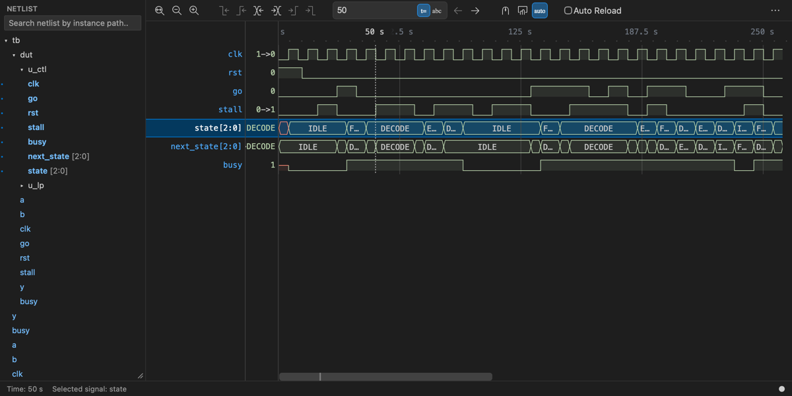
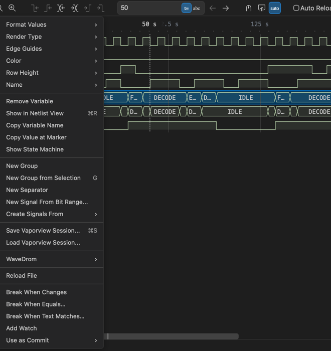
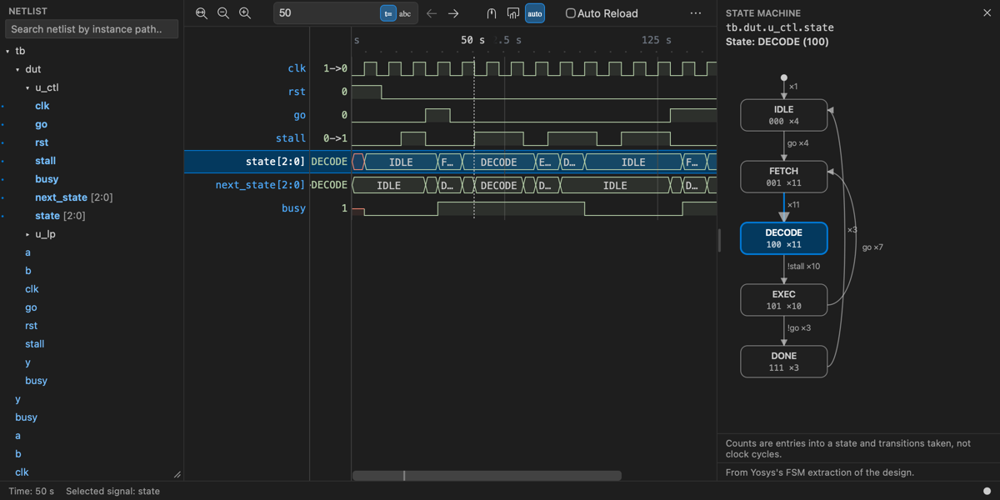
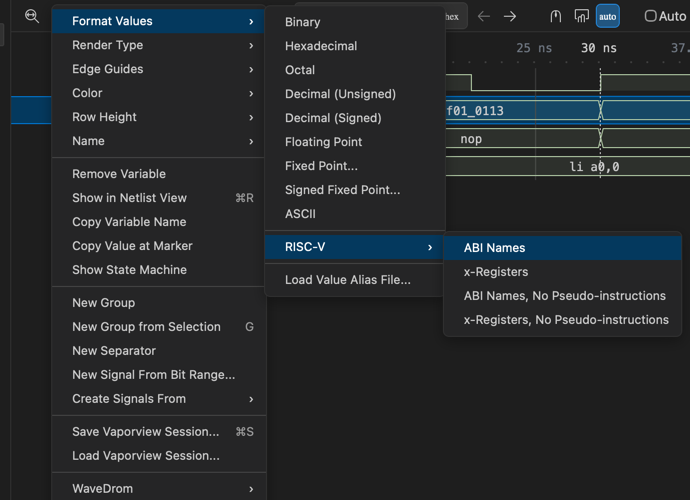
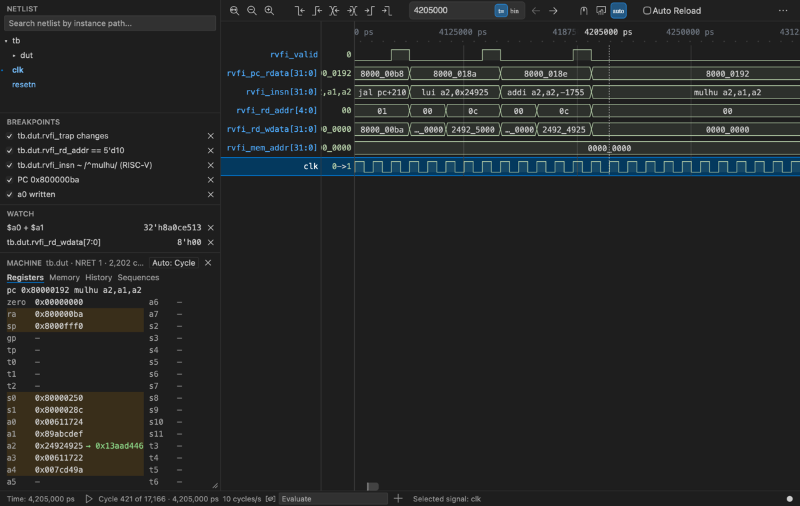
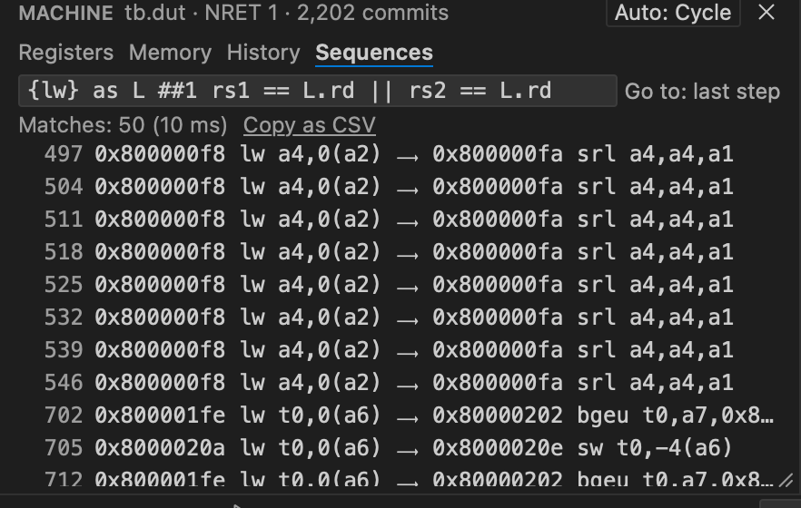

# VaporView in cmux

cmux opens waveform dumps (`.vcd`, `.fst`, `.ghw`, `.fsdb`) in [VaporView](https://github.com/Lramseyer/vaporview),
the GPL-3.0 waveform viewer by Lloyd Ramseyer. Upstream VaporView is a VS Code extension. cmux runs it without
VS Code, reads FSDB in place on a remote host, links it to the SystemVerilog editor, and adds a debugger that steps
through the recorded run.

Open a dump from cmux's file explorer or a terminal link, locally or in an SSH workspace. This document covers
cmux's changes only; [docs/sv-editor.md](../sv-editor.md) is the overview of the whole branch.



*The viewer on the FSM test fixture (`scripts/waveform-viewer-checks/fsm/`, whose dump uses a 1 s timescale).
`state` and `next_state` show their enum member names.*

## Background

VaporView has two halves. The **webview** draws the waveform and talks only through messages. The **extension
host** runs in VS Code: it parses the dump with [wellen](https://github.com/ekiwi/wellen) (in WebAssembly), reads
FSDB through a native addon, and supplies the menus, keys, netlist, sessions and settings.

cmux keeps the webview, nearly unchanged, and replaces the extension host:

| VS Code provides | cmux's replacement |
| --- | --- |
| The webview container and `acquireVsCodeApi()` | A `WKWebView` panel and `vscode-api-shim.js` |
| File reading in a Node worker | `wellen-worker.js`, a Web Worker reading the file through range requests |
| FSDB through a native addon on the Mac | [The FSDB helper](#fsdb-the-viewer-and-the-helper), run on the remote host over SSH |
| Menus, keys, settings, netlist, sessions, undo | `cmux-commands.js`, `cmux-ui.js`, `cmux-netlist.js`, Swift session code |

## Architecture

```
 cmux (Swift)                                          WKWebView page (Resources/vaporview/)
 FilePreviewWaveformSession ── callAsyncJavaScript ──▶  host.js, cmux-*.js      host half and cmux features
                            ◀── postMessage ──────────    └ wellen-worker.js    VCD/FST/GHW parser
 WaveformViewerSchemeHandler ◀── range GET ───────────    └ <iframe> webview.js VaporView, built from the patch
 Waveform*.swift: debugger, machine state, FSM, enums, editor link
 WaveformFSDBHelper ── ssh ──▶ remote host: fsdb-helper-v2 (coordinator + 4 workers + Verdi's reader)
```

- **Swift → page:** `callAsyncJavaScript` on `window.cmuxWaveform` (`open`, `link.*`, `debugger.*`, `machine.*`, ...).
- **Page → Swift:** `webkit.messageHandlers.cmuxWaveform.postMessage({type, ...})`.
- **Page → VaporView frame:** the messages VS Code would send (`add-variable`, `setMarker`, `setDisplayFormat`).
- **Dump bytes** come through the private `cmux-waveform:` scheme, which serves only the bundle and the open file;
  a Content-Security-Policy allows only bundled scripts.

## Features

Menu names are the English strings in the code. Editor-side features (inline values, the listing gutter) have no
screenshots, because those need the full app rather than the off-screen viewer harness.

### VaporView parity

VaporView's VS Code features work in the panel, with the same command IDs:
- its context menus (rows, ruler, netlist) and their `when` rules;
- its keys: ⌘R show in netlist, ⌘F search netlist, F2 rename, ⌘0 zoom to fit, ⌥= / ⌥- row scale, G group, 1 to 8
  color, ⌘Z / ⇧⌘Z undo and redo;
- the netlist tree, with search and drag into the viewer;
- sessions: Save Vaporview Session... (⌘S) and Load Vaporview Session..., in VaporView's JSON format, and
  auto-load of `<dump>.json`. For a dump on an SSH host, save asks where to write;
- settings (right-click the ruler > More Settings...), the status strip, and Auto Reload.

⌘-click a time (`@ 50000`, `50,000 ns`) or an instance path in a cmux terminal to move the marker or add the signal.

By design, a signal already shown is never added twice, and there is no WCP server.



*A row's menu. The items through Reload File are VaporView's; Show State Machine and the items below are cmux's.*

*Files:* `Resources/vaporview/` `cmux-commands.js`, `cmux-ui.js`, `cmux-netlist.js`, `host.js`;
`Sources/Panels/` `FilePreviewWaveformSession.swift`, `WaveformViewerSchemeHandler.swift`,
`WaveformViewerStrings.swift`, `WaveformTerminalLinks.swift`.

### FSDB: the viewer and the helper

FSDB can only be read with Verdi's Linux libraries, so cmux reads it where it lives. Open an FSDB from an SSH
workspace whose host has Verdi. On first use cmux uploads [`fsdb-helper-v2/`](../../Resources/vaporview/fsdb-helper-v2/)
and compiles it there against the host's own Verdi, so no Synopsys code is shipped.

The viewer and the helper then work as one:
- The viewer never holds a big signal whole. It asks the helper for **windows**: one signal over one time range, at
  the zoom on screen, exact or summarized per pixel bucket. It prefetches neighbours, so panning rarely waits.
- The helper keeps four worker processes with the dump open, and answers windows, values at the marker, next edge
  and value search from their in-memory stores.
- Signals with at most 350,000 changes are loaded whole and then behave like local ones.
- If the windowed helper can't start, cmux falls back to whole signals and says so in the status strip.

VCD, FST and GHW are parsed in the page by wellen, local or remote. The helper's design, protocol, timeouts and
decisions are in **[Resources/vaporview/fsdb-helper-v2/README.md](../../Resources/vaporview/fsdb-helper-v2/README.md)**.

*Files:* `Sources/Panels/WaveformFSDBHelper.swift`, `Resources/vaporview/fsdb-helper-v2/`, `fsdb-helper/` (fallback),
`window_cache.ts` in the patch.

### RTL ↔ waveform link

- In the SystemVerilog editor, ⌃W (Add Signal to Waveform) adds the signal under the cursor, placed in the design by
  slang-server. A signal that wasn't dumped is shown through the net it connects to, if there is one.
- In the viewer, ⌥⇧D (Show Waveform Signal in Source) or a double-click jumps to the declaration; ⌃- / ⌃⇧- go back
  and forward.
- The editor shows **inline values** at the marker. Hover an enum to see its member name.
- When the dump names the design differently, View > Waveform Path Mapping... holds the prefix rules.

*Files:* `Sources/Panels/WaveformSourceLink.swift`, `FilePreviewLanguageFeatures.swift`,
`FilePreviewInlineValueOverlay.swift`; `host.js` (`cmuxWaveform.link`).

### Enum names and the state machine view

A row whose signal has an enum type shows member names by default. VCD has no types, so cmux asks slang-server.
Format Values > Enum Names restores them after you pick another format. (slang-server is the SystemVerilog
language server cmux's editor uses; it needs a file of the design open in the editor.)

Right-click a state register > **Show State Machine** for a pane with its states and transitions, the state at the
marker, and counts of entries and transitions taken. Click a transition to jump to its next occurrence (⇧-click:
previous). The graph comes from Verdi (Synopsys's debug suite, used only where installed, and only with the VCS
`-kdb` database next to the dump), else Yosys, else the dump alone. A note under the graph names the engine.



*The FSM fixture with the marker in DECODE. The model is the Yosys engine's answer for this design.*

*Files:* `cmux-enum.js`, `cmux-fsm.js`, `fsm/`; `Sources/Panels/WaveformEnumLink.swift`, `WaveformFSMEngines.swift`;
`Packages/Shared/CmuxSyntaxHighlighting/.../Fsm/`, `SlangEnumTypes.swift`.

### RISC-V and value aliases

- **Format Values > RISC-V** shows a 16-bit or wider value as an instruction, in four styles (ABI or x-register
  names, with or without pseudo-instructions). It matches GNU objdump on 60,847 test encodings, for RV32IMC, Zicsr,
  Zifencei and the privileged instructions.
- **Format Values > Load Value Alias File...** names values from a Verdi-style `.alias` file, `.rc` alias lines,
  JSON or CSV. Sessions remember the file.

 RISC-V and its four styles">

*Files:* `riscv_disasm.ts`, `value_alias.ts`, `extra_formats.ts` in the patch; `Sources/Panels/WaveformValueAliasFiles.swift`.

### The debugger

The dump is a recorded run, so cmux steps through it like gdb, in both directions.

- **Step:** F10 one clock cycle forward, ⇧F10 back, or play at N cycles/s. cmux picks the clock; Use Selected
  Signal as Clock overrides it.
- **Locals:** a group of the signals in the editor's current instance, following the cursor.
- **Editor highlights:** each step tints the signals that changed and their driver lines. Rows the editor
  highlights light up in the viewer too.
- **Breakpoints:** F5 continues to the next one, ⇧F5 to the previous one (F5 with none enabled plays). Kinds: Break
  When Changes and Break When Equals... on a row; F9 on an editor line (stops when a signal it assigns changes);
  Break When Text Matches... (a regex over the row's shown text, such as `^csrw`); and the instruction kinds below.
  Any of them can take a condition. While playing, F5 pauses.
- Stop Debugging ends stepping and removes Locals. Every item of View > Waveform Debugger is in the command
  palette, and the keys can be rebound in cmux's keyboard settings.
- **Evaluate and watches:** SystemVerilog expressions, with IEEE 1800 widths and 4-state results, in the Evaluate
  field or as watches that update every step.



*The PicoRV32 fixture (a test program on the upstream core) at cycle 421: five breakpoint kinds, two watches, the
Machine section, the cycle strip and Evaluate.*

*Files:* `cmux-debugger.js`, `cmux-expr.js`, `cmux-debugger-text.js`; `Sources/Panels/WaveformDebugger*.swift`.

### Machine state, listings and instruction breakpoints

For a CPU that dumps its retired instructions in [RVFI](https://github.com/YosysHQ/riscv-formal/blob/main/docs/rvfi.md)
form (or close to it; Use as Commit maps others), cmux replays every commit into registers and memory.

- **Machine section:** Registers, Memory, History, and CSRs when the dump has them, at the marker, like gdb's
  `info registers` and `x/`.
  Evaluate takes `$a0`, `$pc`, `$mem32(addr)` and gdb commands. A register's menu has Who Last Wrote This and
  Break When Written. F10 steps by instruction while the section has focus.
- **Program image:** Load ELF for Machine State... fills memory the program never wrote and checks loads.
- **Sequences:** search the instruction stream with SVA-like syntax, one commit per tick:
  `{lw} as L ##1 rs1 == L.rd || rs2 == L.rd` finds load-use pairs. *(Coming: Break When Sequence Matches....)*
- **Listings:** open the program's objdump output in the editor. F9 there sets a PC breakpoint, and stepping marks
  the current instruction. After a rebuild, breakpoints follow their code and moves are reported.
- **More instruction breakpoints** (Add Instruction Breakpoint...): Break at Address..., Break When Next
  Instruction Matches..., Break When Written....



*Files:* `cmux-machine-core.js`, `cmux-machine.js`, `cmux-sequence.js`, `cmux-debugger-commits.js`;
`Sources/Panels/WaveformMachineState.swift`, `WaveformDebuggerAsmBreakpoints.swift`; the package's `AsmListing/`.

*Coming:* **Trace-X** follows a value, or an X, back through its drivers to where it came from, with Verdi on the
remote host when present, otherwise slang and cmux's own evaluator.

## Maintaining the patch

All edits to VaporView's sources are one file,
[`source/cmux-vaporview.patch`](../../Resources/vaporview/source/cmux-vaporview.patch), against upstream `59107c6`
(tag `1.6.1-beta`). It is the GPL corresponding source of the bundled `webview.js`; its `CHANGES.md` explains each
change, and every edit to an upstream file carries a `// cmux:` comment.

Rebuild byte for byte from a clean checkout of `59107c6`:

```sh
git apply cmux-vaporview.patch && npm ci && npm run compile-wasm && node esbuild.js --production
# dist/webview.js is Resources/vaporview/webview.js
```

Don't copy the `filehandler.wasm` that `compile-wasm` builds; it lacks the wellen fix. The bundled one comes from
`scripts/waveform-viewer-checks/wellen/build-wasm.sh`. The patch's `test/riscv/` tests need GNU objdump output,
which the patch leaves out; generate it with a RISC-V binutils:

```sh
cd test/riscv && python3 gen_corpus.py && RISCV_BIN=<riscv binutils bin dir> ./make_expected.sh && node run.cjs
```

To move to a new upstream: apply the patch with `git apply -3` on the new tag, resolve conflicts by their `cmux:`
comments, rebuild, run the VaporView tests and the suites below, then regenerate the patch
(`git diff <new tag> <branch> -- . ':(exclude)test/riscv/*.gz'`) and update the commit in
[`Resources/vaporview/README.md`](../../Resources/vaporview/README.md), which records how the bundled files were
built.

## Testing

`scripts/waveform-viewer-checks/run.sh <suite>` loads the real page through the app's scheme handler in an
off-screen `WKWebView`, or runs the page's scripts in JavaScriptCore. No window opens.

| Area | Suites |
| --- | --- |
| Parity, security, editor link, enums, FSM, RISC-V | `parity`, `xss`, `link`, `enum`, `enum-link`, `fsm`, `riscv` |
| FSDB | `windowed` (mock helper, real relay); `fsdb`, `windowed-fsdb`, `windowed-launcher` need a host with Verdi |
| Debugger | `debugger`, `debugger-editor`, `breakpoints`, `line-breakpoints`, `expr`, `text`, `text-breakpoints` |
| CPU traces | `machine-core`, `machine`, `machine-mutants`, `commit-breakpoints`, `commit-page`, `asm-listing` |

Swift package tests cover the FSM model, listings, line breakpoints and path mapping. `docs-shots/make-shots.sh`
regenerates the screenshots here from open fixtures.

## Licenses and credits

- **VaporView** (GPL-3.0), Lloyd Ramseyer and contributors: the webview, the patch, and the files adapted from its
  extension host.
- **wellen** (BSD-3-Clause), Kevin Laeufer, with cmux's fix to its split-bit merge.
- **slang** (MIT): the expression semantics, reimplemented. **riscv-formal** (ISC): the RVFI names. **Compiler
  Explorer** (BSD-2-Clause): the objdump listing parser, ported.
- The machine fixtures simulate the unmodified NERV and PicoRV32 (ISC) and Ibex (Apache-2.0) cores.
- **Verdi's FSDB reader is never bundled**; the helper links it on the host
  ([`NOTICE`](../../Resources/vaporview/fsdb-helper-v2/NOTICE)). Full list:
  [`THIRD_PARTY_LICENSES.md`](../../THIRD_PARTY_LICENSES.md).

## Upstream bugs found

Fixed here, to be reported upstream:
- **VaporView:** dump text (names, tooltips, values) reaches `innerHTML` unescaped, so a crafted dump can inject markup.
- **VaporView:** Undo with an expanded group throws, because a row is disposed twice.
- **VaporView:** numeric value search matches substrings of the bits: hex `5` also finds `0x15`.
- **wellen 0.25.7:** merging a VCD's bit-blasted vector (`valid [0]`, `valid [1]`) corrupts values when the bits
  start at different times or one is never written.
